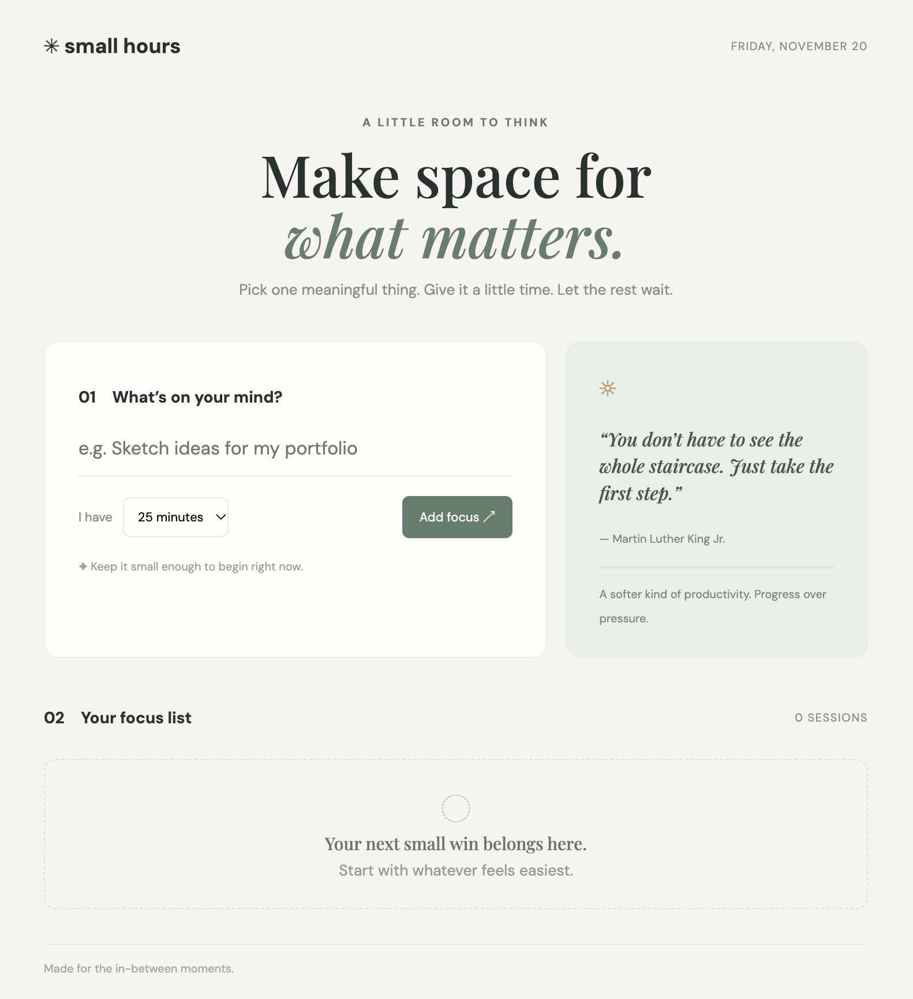
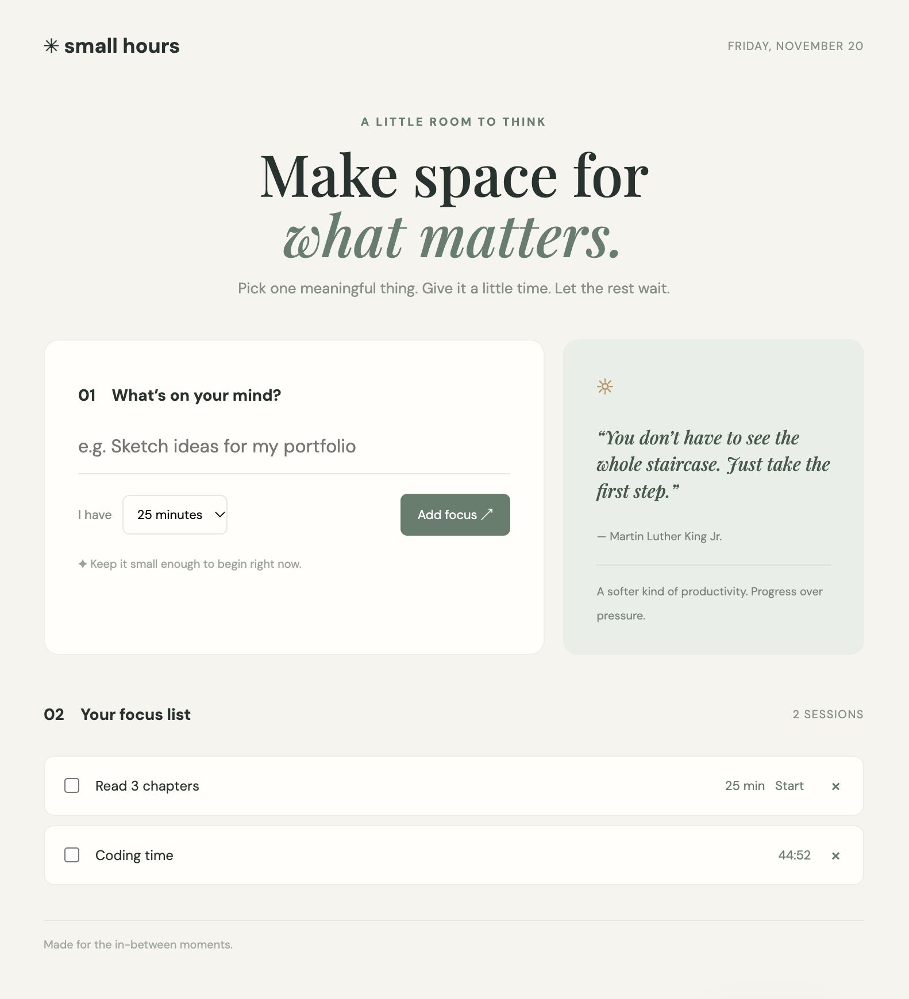

# Small Hours

A gentle focus planner that helps you turn a large to-do list into one small, timed next step.

## Description

Small Hours lets you add tasks, choose a 15, 25, or 45-minute focus session, run a countdown, and mark tasks complete. Tasks are saved in your browser's local storage.

## Purpose

I built Small Hours for students and busy people who can feel stuck when a to-do list gets too large. It helps users choose one manageable task and get started without creating an account.

## Features

- Add and delete focus tasks.
- Choose a 15, 25, or 45-minute session.
- Start a countdown for a task.
- Mark tasks complete and clear completed tasks.
- Save tasks in browser local storage.
- Responsive layout for desktop and mobile.

## Technologies

- TypeScript
- React
- Vite
- Browser local storage
- CSS

## AI Tools Used

OpenAI Codex assisted with planning, writing, and refining the application.

## Installation

Install [Node.js](https://nodejs.org/) if it is not already installed. Then clone the repository and install its dependencies:

```bash
git clone https://github.com/TeresaH16/Focus-Planner.git
cd Focus-Planner
npm install
```

## Running the Application

Start the development server:

```bash
npm run dev
```

Open the **Local** address printed in the terminal, usually `http://localhost:5173/`. Keep the terminal open while using the app. Press `Ctrl+C` in the terminal to stop the server.

## How AI Was Used

Codex helped shape the app's purpose and interface, implement the task and timer interactions, and migrate the project to React and TypeScript. I reviewed the generated code and checked that adding a task displays it in the focus list.

Examples of prompts that influenced the application:

1. "Build a calm, useful focus planner for people who feel overwhelmed by big to-do lists. Make it a simple browser app."
2. "Add task entry, 15, 25, and 45-minute session choices, a countdown timer, completion controls, and browser storage."
3. "Convert the focus planner to React and TypeScript, keeping the interface simple and responsive."

## Testing

The app was opened in a browser, and adding a task was confirmed to display it in the focus list. Before submission, also test:

- Starting a timer and confirming it completes the task.
- Reloading the page and checking that tasks remain saved.
- Completing and deleting tasks.
- The layout on a narrow screen.
- Installing and starting the app by following the instructions above.

## Screenshots

- The planner with no tasks.
- The planner with one or more tasks in the focus list.





## Future Improvements

- Add pause and resume controls for a timer.
- Allow users to reorder tasks and group them by project.
- Add an optional sound or notification when a session ends.

## Vibe Coding Reflection

### 1. What did AI do particularly well?

Codex helped create a working first version quickly, giving me an interface and task flow to refine.

### 2. What did AI do poorly?

AI-generated code still needs review. For example, timer behavior has edge cases such as removing a task while its timer is running. I needed to inspect that behavior rather than assuming the generated code handled it correctly.

### 3. How did you verify AI-generated code?

I opened the application in a browser and confirmed that submitting a task added it to the focus list. More testing is still needed for timer completion, persistence after reload, and mobile layout.

### 4. How did your prompts evolve?

I started with a general request for a simple focus app. I improved the prompt by specifying who might use it and what interactions it needed, including task entry, session lengths, a countdown, and saved tasks.

### 5. What did you learn?

I learned that prompts are more useful when they describe behaviors that can be checked. I also learned that browser features such as timers and local storage need testing beyond whether the page initially appears.

### 6. Would you trust AI to build the entire application without human supervision?

No. AI can help write and revise code, but a person still needs to run the app, test its behavior, and take responsibility for the finished project.